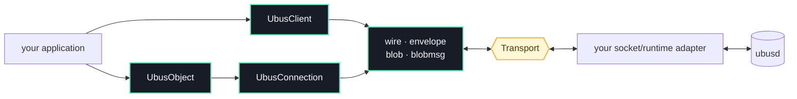

<p align="center">
  
</p>

<p align="center">
  <a href="https://github.com/no-std-rs/ubus-zero/actions/workflows/ci.yml"></a>
  <a href="LICENSE"></a>
  
</p>

`ubus-zero` is a small, runtime-neutral implementation of the
[OpenWrt ubus](https://openwrt.org/docs/techref/ubus) wire protocol. It gives
Rust programs a synchronous client, an object provider, and compatible
blob/blobmsg codecs without requiring the standard library.

The workspace also provides the Linux broker [`ubusd`](https://github.com/no-std-rs/ubus-zero/blob/main/crates/ubusd/README.md) and
[`ubus-client`](https://github.com/no-std-rs/ubus-zero/blob/main/crates/ubus-client/README.md). `ubus-client` supports object
discovery, calls, events, subscriptions, monitoring, JSON Lines batches, and
object providers that run external programs. Install both tools from the Git repository:

```sh
cargo install --git https://github.com/no-std-rs/ubus-zero ubusd
cargo install --git https://github.com/no-std-rs/ubus-zero ubus-client
```

Start the broker in one terminal:

```sh
ubusd --socket /tmp/ubus.sock
```

In another terminal, list registered objects using the same socket:

```sh
ubus-client -s /tmp/ubus.sock list
```

The broker routes requests to registered services; it does not provide OpenWrt
services such as `system` by itself. See the [CLI guide](https://github.com/no-std-rs/ubus-zero/blob/main/crates/ubus-client/README.md)
to register your own provider with `serve`.

Non-root clients need ACL grants for named object registration, method calls,
subscriptions, and events. See the [daemon guide](https://github.com/no-std-rs/ubus-zero/blob/main/crates/ubusd/README.md#access-control)
for an example. Root clients bypass ACLs; monitoring requires root.

## Use the library

The Cargo package is `ubus-zero`; the library name is simply `ubus`. To use the
library from this Git repository:

```toml
[dependencies]
ubus = { package = "ubus-zero", git = "https://github.com/no-std-rs/ubus-zero", default-features = false }
```

Given a connected `Transport` and a service providing `system.board`:

```rust
extern crate alloc;

use alloc::vec::Vec;
use ubus::client::UbusClient;
use ubus::{BlobMsgTable, Transport};

fn board<T: Transport>(transport: T) -> ubus::Result<Vec<u8>> {
    let mut client = UbusClient::connect(transport)?;
    let system = client.lookup("system")?;
    client.invoke(system, "board", &BlobMsgTable::empty())
}
```

`UbusClient::connect` performs the ubus handshake over the supplied transport.
`invoke` returns the last DATA reply as blobmsg table contents. `invoke_many`
returns all DATA replies, or an empty list when a call succeeds without a DATA reply.

## Why ubus-zero?

- `no_std + alloc`: protocol code stays independent of Linux, sockets,
  executors, and logging stacks.
- Both sides of the wire: look up and invoke objects, or register and serve
  your own.
- Native ubus data model: strict frame, blob, blobmsg, envelope, and status
  handling.
- Bring your own runtime: a deliberately small `Transport` trait is the only
  platform seam.
- Differentially tested: an internal Rust broker and pinned OpenWrt reference
  binaries exercise the same compatibility corpus.

“Zero” is the family name—not a claim of zero allocations, zero copies, or zero
dependencies. The crate requires an allocator and intentionally favors explicit
protocol behavior over magic.

## Design



With no features enabled, the library never opens a socket. A transport sends
complete `wire::Frame` values, returns complete incoming frames, and supplies
the wait hook used between non-blocking receive attempts. That separation keeps
the API usable in embedded runtimes, Linux daemons, simulators, and deterministic
test harnesses.

Optional features provide reusable adapters extracted from Cellctl:

- `json`: `ubus::json::{json_to_blobmsg, blobmsg_to_json}` converts nested JSON
  objects and validates blobmsg replies, using `alloc` without `std`.
- `unix`: `ubus::unix::UnixUbusTransport` opens Linux Unix sockets through
  rustix and supports monotonic request deadlines, using `alloc` without `std`.

Add `features = ["json", "unix"]` to the dependency declaration to enable both.
For example, on Linux with `unix` enabled:

```rust
use core::time::Duration;
use ubus::client::UbusClient;
use ubus::unix::UnixUbusTransport;

fn ping() -> ubus::Result<()> {
    let mut transport = UnixUbusTransport::connect("/tmp/ubus.sock")?;
    transport.set_deadline(Some(Duration::from_secs(5)));
    let mut client = UbusClient::connect(transport)?;
    client.transport_mut().set_deadline(Some(Duration::from_secs(5)));
    client.ping()
}
```

Reset the transport deadline before each request when reusing a connection.
The client also supports object/signature discovery, events, subscriptions,
and monitoring.
`UbusClient::request` and the methods built on it (such as `invoke_many`) buffer
asynchronous frames for `recv_frame`. The simpler `lookup` and `invoke` methods
do not retain unrelated frames, so use the request-based methods when mixing
calls with events or subscriptions. See [Cellctl imports](docs/cellctl-imports.md)
for the source and adaptations of these APIs.

### ESP32 router display

The [ESP32-C3 router display example](examples/esp32c3-router-display/README.md)
turns the GUITION ESP32-2424S012 round-screen gadget into a live OpenWrt
dashboard: WAN traffic and history, memory/load/uptime, Wi-Fi clients, link
counters, and router identity. It includes `no_std` firmware, the original
animation gadget's pin configuration, a read-only rpcd account/ACL, router
setup, and build/flash instructions. It connects over Wi-Fi through uhttpd's
`/ubus` JSON-RPC bridge using this crate's blobmsg/JSON codecs.

Targets without pointer-width atomics, including ESP32-C3, can enable
`portable-atomic` for the shared-buffer transport helpers and spin mutex.
The application must configure `portable-atomic`'s appropriate fallback; this
single-core example enables `unsafe-assume-single-core`. The protocol library
continues to require only `core` and `alloc`.

### Provide an object

```rust
use ubus::server::UbusConnection;
use ubus::{BlobMsgTable, Transport, UbusObject};

fn register_echo<T: Transport>(transport: T) -> ubus::Result<UbusConnection<T>> {
    let object = UbusObject::new("example.echo").method("ping", |_request| {
        Ok(BlobMsgTable::build(|reply| {
            reply.put_str(Some("message"), "pong");
        }))
    });

    UbusConnection::connect_and_register(transport, object)
}
```

Keep the returned connection alive and call `poll_one()` repeatedly from your
application's event loop. Each call processes at most one frame;
`DispatchOutcome::Idle` means no complete frame is available, so the caller
should wait or yield before polling again. Registration alone does not dispatch
requests.

Handlers receive the contents of the request's blobmsg table and return a
`BlobMsgTable`. Handler failures become an ubus status and are also reported as
`DispatchOutcome::HandlerErr`.

### Read a reply

```rust
use ubus::blobmsg;

fn hostname(reply: &[u8]) -> Option<&str> {
    blobmsg::lookup(reply, "hostname")?.as_str()
}
```

## Scope

`ubus-zero` is a focused protocol implementation, not a source-compatible port
of the C `libubus` API. The current API is synchronous and
uses non-blocking receives. Client requests and registration wait for replies
through `Transport::wait_recv`; provider dispatch uses `poll_one`. Callers choose
their transport and control deadlines and scheduling. The optional Linux adapter
provides socket I/O; the protocol core can use a custom transport.

The project is pre-1.0. Minor versions may refine public APIs, but wire
compatibility is guarded by canonical transcripts, checked-in goldens, fault
injection, and cross-broker tests. The full test doctrine lives in
[Compatibility testing](https://github.com/no-std-rs/ubus-zero/blob/main/docs/compatibility.md).

## Repository

The protocol library, daemon and CLI are public packages. `ubus-testkit` and
its workspace FFI shim remain internal compatibility infrastructure. The
existing [`libubox-sys`](https://crates.io/crates/libubox-sys) package is maintained
in [`pawelchcki/libubox`](https://github.com/pawelchcki/libubox).

```text
.
├── src/                  public no_std protocol library
├── crates/ubusd/         public daemon and embeddable broker
├── crates/ubus-client/   public CLI-only package
├── crates/testkit/       private matrix, goldens, shims, and fault tools
├── crates/libubox-sys/   internal reference-implementation FFI shim
├── tests/                cross-broker integration suites
└── tools/                pinned OpenWrt fixture builder
```

For local development on Linux, use the pinned Rust toolchain and a C compiler
(`cc`) for the testkit's fault-injection shims. Run these checks from the
repository root:

```sh
cargo fmt --all -- --check
cargo clippy --workspace --all-targets --all-features -- -D warnings
cargo build -p ubusd --features testing
cargo test --workspace --all-features
```

The default test run exercises the Rust implementation and checked-in goldens;
tests needing absent OpenWrt fixtures are skipped. To run the full live
compatibility suite, build the pinned OpenWrt fixtures with Docker Buildx and
require them:

```sh
tools/ubusd-builder/build.sh
python3 tools/ubus-compat-check.py
```

See the [contributing guide](https://github.com/no-std-rs/ubus-zero/blob/main/CONTRIBUTING.md)
for the complete development flow.

## Security and releases

Runnerless manages release PRs and publishes verified release assets to crates.io.
A credentialless GitHub Actions job prepares the packages; registry credentials
stay in Runnerless's encrypted Production vault. See the [security policy](https://github.com/no-std-rs/ubus-zero/blob/main/SECURITY.md)
for vulnerability reporting and [publishing guide](https://github.com/no-std-rs/ubus-zero/blob/main/docs/publishing.md)
for the release controls.

## License

Licensed under the [Apache License, Version 2.0](https://github.com/no-std-rs/ubus-zero/blob/main/LICENSE).
