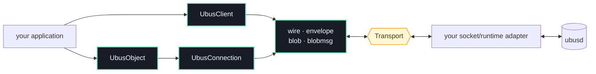

<p align="center">
  
</p>

<p align="center">
  <a href="https://github.com/pawelchcki/ubus-zero/actions/workflows/ci.yml"></a>
  <a href="https://crates.io/crates/ubus-zero"></a>
  <a href="https://docs.rs/ubus-zero"></a>
  <a href="LICENSE"></a>
  
</p>

`ubus-zero` is a small, runtime-neutral implementation of the
[OpenWrt ubus](https://openwrt.org/docs/techref/ubus) wire protocol. It gives
Rust programs a synchronous client, an object provider, and compatible
blob/blobmsg codecs without requiring the standard library.

The crates.io package is `ubus-zero`; the library name is simply `ubus`:

```toml
[dependencies]
ubus = { package = "ubus-zero", version = "0.1", default-features = false }
```

```rust
use ubus::client::UbusClient;
use ubus::{BlobMsgTable, Transport};

fn board<T: Transport>(transport: T) -> ubus::Result<Vec<u8>> {
    let mut client = UbusClient::connect(transport)?;
    let system = client.lookup("system")?;
    client.invoke(system, "board", &BlobMsgTable::empty())
}
```

## Why ubus-zero?

- `no_std + alloc`: protocol code stays independent of Linux, sockets,
  executors, and logging stacks.
- Both sides of the wire: look up and invoke objects, or register and serve
  your own.
- Native ubus data model: strict frame, blob, blobmsg, envelope, and status
  handling.
- Bring your own runtime: a deliberately small `Transport` trait is the only
  platform seam.
- Differentially tested: an internal Rust broker and pinned OpenWrt reference
  binaries exercise the same compatibility corpus.

“Zero” is the family name—not a claim of zero allocations, zero copies, or zero
dependencies. The crate requires an allocator and intentionally favors explicit
protocol behavior over magic.

## Design



The protocol crate never opens a socket. A transport sends complete
`wire::Frame` values, returns complete incoming frames, and supplies the wait
hook used between non-blocking receive attempts. That separation keeps the API
usable in embedded runtimes, Linux daemons, simulators, and deterministic test
harnesses.

### Provide an object

```rust
use ubus::server::UbusConnection;
use ubus::{BlobMsgTable, DispatchOutcome, Transport, UbusObject};

fn serve_once<T: Transport>(transport: T) -> ubus::Result<DispatchOutcome> {
    let object = UbusObject::new("example.echo").method("ping", |_request| {
        Ok(BlobMsgTable::build(|reply| {
            reply.put_str(Some("message"), "pong");
        }))
    });

    let mut connection = UbusConnection::connect_and_register(transport, object)?;
    connection.poll_one()
}
```

Handlers receive the contents of the request's blobmsg table and return a
`BlobMsgTable`. Handler failures become an ubus status and are also reported as
`DispatchOutcome::HandlerErr`.

### Read a reply

```rust
use ubus::blobmsg;

fn hostname(reply: &[u8]) -> Option<&str> {
    blobmsg::lookup(reply, "hostname")?.as_str()
}
```

## Scope

`ubus-zero` is a focused protocol implementation, not a source-compatible port
of the C `libubus` API. The current API is synchronous and
non-blocking-poll-oriented. Callers own connection establishment, deadlines,
scheduling, and their concrete transport.

The project is pre-1.0. Minor versions may refine public APIs, but wire
compatibility is guarded by canonical transcripts, checked-in goldens, fault
injection, and cross-broker tests. The full test doctrine lives in
[Compatibility testing](https://github.com/pawelchcki/ubus-zero/blob/main/docs/compatibility.md).

## Repository

Only the root `ubus-zero` package is published.

```text
.
├── src/                  public no_std protocol library
├── crates/ubusd/         private pure-Rust compatibility broker
├── crates/testkit/       private matrix, goldens, shims, and fault tools
├── crates/libubox-sys/   private reference-implementation FFI
├── tests/                cross-broker integration suites
└── tools/                pinned OpenWrt fixture builder
```

Start with:

```sh
cargo fmt --all -- --check
cargo clippy --workspace --all-targets --all-features -- -D warnings
cargo build -p ubusd-rs --features testing
cargo test --workspace --all-features
```

Building the pinned OpenWrt comparison binaries requires Docker Buildx:

```sh
tools/ubusd-builder/build.sh
UBUS_ZERO_COMPAT=require cargo test --workspace --all-features
```

See the [contributing guide](https://github.com/pawelchcki/ubus-zero/blob/main/CONTRIBUTING.md)
for the complete development flow.

## Security and releases

Releases after the initial crates.io bootstrap use GitHub OIDC trusted
publishing through a reviewer-protected `crates-io` environment. The repository
stores no crates.io token. See the [security policy](https://github.com/pawelchcki/ubus-zero/blob/main/SECURITY.md)
for vulnerability reporting and [publishing guide](https://github.com/pawelchcki/ubus-zero/blob/main/docs/publishing.md)
for the release controls.

## License

Licensed under the [Apache License, Version 2.0](https://github.com/pawelchcki/ubus-zero/blob/main/LICENSE).
